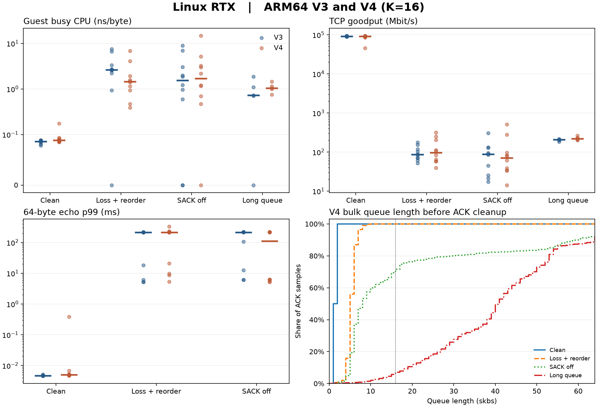

# #16 ARM64에서 TCP 재전송 큐의 RB와 하이브리드 비교

**RB 기본값을 유지한다.** 손실 없는 bulk 전송 10쌍에서 하이브리드(K=16)의 수신 바이트당 CPU 시간은 RB 대비 1.7% 늘었다(95% 구간 −0.3%~+12.9%). 같은 조건의 64바이트 요청·응답 p99는 4.8% 늘었다(+2.7%~+25.2%). 이 환경에서는 하이브리드 기본 활성화, K 축소, 캐시·tail 기본 활성화를 뒷받침하는 CPU 절감 근거를 얻지 못했다. 커널 기본 설정과 송수신 경로에는 변경이 없다. [이슈 #16](https://github.com/leesihyeong17/linux-rtx-hybrid/issues/16)

## 비교 조건

#14 통합과 #15의 B·C 기본 경계 회귀 결과를 출발점으로 삼았다. 앞선 #25 문서는 캐시와 tail을 분리할 수 있는 RB 대조군과 예비 벤치마크를 제공한다. 여기서는 동일 ARM64 게스트에서 실제 TCP와 커널 연산을 각각 반복했다. [#15 기본 회귀 기록](https://github.com/leesihyeong17/linux-rtx-hybrid/issues/15#issuecomment-6909049483) · [#25 구현 및 예비 결과](issue-16-b-benchmark-tail.md)

| 구성 | 소스와 차이 |
|---|---|
| V0, V1 | 각각 원본 RB `991defcc5`, 공통 API 전환 RB `231db9ed6` |
| RB 기본, RB+CACHE, V3 | 통합본 `f78f5626a`에서 캐시·tail 모두 off, 캐시만 on, 캐시·tail 모두 on |
| V4 | V3와 같은 소스·캐시·tail에 HYBRID on. 주 비교 K=16, 별도 비교 K=4 |
| 계측·연산 구성 | STATS와 ACK 시점 LIST 길이 계측을 함께 켠 별도 이미지. 연산 전용 이미지는 #36 fixture `0df8dcd98`에 lookup/unlink와 보조 append를 추가. TCP 성능 이미지는 DEBUG·STATS off |

호스트는 Apple Silicon Mac17,2(논리 CPU 10개, 메모리 24 GiB, macOS 26.6.2), 게스트는 vfkit 0.6.4의 ARM64 Linux 5.4.214, 1 vCPU·768 MiB다. Ubuntu 20.04 ARM64 GCC 9.4.0으로 빌드했다. 게스트 안에서 두 네트워크 namespace를 MTU 1500 veth로 연결했다. 이 수치는 단일 가상 CPU가 양쪽 endpoint를 실행한 로컬 경로에 해당한다. 호스트 코어 고정, 물리 NIC, 팀 공용 VM에서의 측정은 수행하지 않았다. [빌드별 SHA와 설정](../../evidence/B/issue-16-arm64/boots.csv) · [Kconfig 대조](../../evidence/B/issue-16-arm64/config-diffs.csv)

- **clean**은 손실·추가 지연·재정렬이 없는 조건이다. **impaired**는 양방향에 각각 손실 0.5%, 총 추가 RTT 4 ms, 송신 방향 재정렬 10%를 적용했다. **no-sack**은 impaired와 같은 설정에서 양쪽 SACK을 껐다. 세 조건 모두 veth 기본 offload를 사용했다. 각 조건에서 0.25초 워밍업 뒤 bulk와 64바이트 요청·응답(RR)을 각각 1초 실행했다.
- **long**은 실제 TCP에서 긴 큐와 승격을 관찰하기 위해 추가했다. 양방향 지연 각 20 ms, 손실·재정렬 0, SACK on, 양쪽 TSO/GSO/GRO off, netem limit 10000에서 1초 워밍업 뒤 2초 bulk를 실행했다. 이 설정은 큐 길이와 offload를 함께 바꾸므로 clean과의 차이 전체를 큐 길이 효과로 해석할 수 없다.
- 주 지표는 측정 전에 정한 clean bulk의 게스트 busy ns/수신 byte다. 반복 번호가 같은 두 부팅을 한 쌍으로 묶고 실행 순서를 교대했다. 아래 변화율은 쌍별 (V4/V3−1)의 중앙값이며 대괄호는 쌍 단위 bootstrap 95% 구간이다(10,000회, seed 16). 기준 CPU가 0 tick인 쌍은 변화율에서만 제외했다. 개별 중앙값과 변화율은 계산 방식이 달라 비율이 일치하지 않을 수 있다. [실행 전 조건과 보조 시험 추가 이유](../../tests/comparison/plan.md)

## 실제 TCP 결과

| 조건 | 지표 | V3 중앙값 | V4 중앙값 | 쌍별 변화율 [95% 구간, %] | 유효 쌍 |
|---|---|---:|---:|---:|---:|
| clean | bulk CPU (ns/B) | 0.086 | 0.089 | +1.7% [-0.3, +12.9] | 10/10 |
| clean | bulk goodput (Mbit/s) | 91,088 | 91,078 | -0.3% [-4.9, +1.2] | 10/10 |
| clean | RR p99 (µs) | 4.688 | 4.958 | +4.8% [+2.7, +25.2] | 10/10 |
| impaired | bulk CPU (ns/B) | 2.632 | 1.440 | -45.2% [-85.1, +0.0] | 9/10 |
| impaired | bulk goodput (Mbit/s) | 85.9 | 95.7 | +11.1% [-25.6, +58.7] | 10/10 |
| impaired | RR p99 (µs) | 213,734 | 214,420 | +1.8% [-26.7, +53.0] | 10/10 |
| no-sack | bulk CPU (ns/B) | 1.541 | 1.689 | -13.2% [-82.7, +70.5] | 8/10 |
| no-sack | bulk goodput (Mbit/s) | 87.5 | 70.6 | -4.6% [-52.0, +358.3] | 10/10 |
| no-sack | RR p99 (µs) | 213,561 | 110,225 | -49.1% [-97.3, +1756.4] | 10/10 |
| long | bulk CPU (ns/B) | 0.727 | 1.044 | +1.3% [-38.5, +99.5] | 4/5 |
| long | bulk goodput (Mbit/s) | 207.5 | 220.9 | +6.4% [-7.8, +31.4] | 5/5 |

clean에서 CPU 절감 목표(3%)에 도달하지 못했고, goodput 구간은 −2% 아래까지, p99 구간은 +5% 위까지 걸쳤다. 세 값은 팀 문서의 **제안 기준**이다. 손실 조건은 단일 부팅의 RR 요청 수가 줄어 꼬리 지연의 변동이 컸다. 예를 들어 impaired에서 V3는 부팅당 106~220개, V4는 49~218개를 수집했다. 이 결과만으로 손실이나 SACK on/off에서 개선 방향을 정하기 어렵다. [팀 측정 계약](../B_D_MEASUREMENT_CONTRACT.md) · [부팅별 지표와 RR 표본 수](../../evidence/B/issue-16-arm64/tcp.csv)

그림의 점은 독립 부팅, 짧은 가로선은 구성별 중앙값이다. 마지막 패널은 V4 계측 부팅의 bulk ACK를 합친 누적분포다. 절대값 사분위수와 범위, 조건별 CPU·goodput·p50·p99·메모리의 쌍별 변화율은 CSV에 있다. [전체 비교표](../../evidence/B/issue-16-arm64/comparisons.csv)

## 큐가 길어질 때의 비용

N은 ACK 정리 직전 전체 skb 수, L은 같은 시점의 LIST 길이다. 아래 값은 V4 계측 부팅 5회의 이벤트를 합산했다. 마지막 열은 적중·미적중을 합한 실제 `find_cover` 호출당 평균 방문 노드 수다. 승격의 분모는 append·ordered·split 삽입 횟수의 합이다.

| 조건 | ACK 횟수 | N≤16 | N>64 | 평균 L | 승격/삽입 | 검색 단계 V3 / V4 |
|---|---:|---:|---:|---:|---:|---:|
| clean bulk | 1,734,753 | 100.0% | 0.0% | 1.50 | 0/1,734,838 (0.00%) | 조회 0회 / 조회 0회 |
| clean rr | 2,540,488 | 100.0% | 0.0% | 1.00 | 0/2,540,493 (0.00%) | 조회 0회 / 조회 0회 |
| impaired bulk | 3,001 | 100.0% | 0.0% | 5.43 | 0/5,553 (0.00%) | 2.433 / 3.852 |
| impaired rr | 1,866 | 100.0% | 0.0% | 1.00 | 0/1,861 (0.00%) | 조회 0회 / 조회 0회 |
| no-sack bulk | 3,013 | 71.5% | 7.3% | 9.92 | 553/4,293 (12.88%) | 조회 0회 / 조회 0회 |
| no-sack rr | 1,794 | 100.0% | 0.0% | 1.00 | 0/1,789 (0.00%) | 조회 0회 / 조회 0회 |
| long bulk | 7,677 | 7.0% | 8.2% | 15.72 | 8,720/10,626 (82.06%) | 4.889 / 3.300 |

clean bulk에서는 삽입 1,734,838회 동안 승격이 한 번도 없었다. long에서는 LIST가 평균 15.72개로 K=16에 가까웠고 삽입의 82.06%에서 승격이 발생했다. 승격은 기존 skb를 RB 트리에 연결하면서 재균형 비용을 치른다. 따라서 LIST tail 연결 비용만으로 하이브리드 전체 삽입 비용을 설명할 수 없다. SACK 손실 조건에서는 V4가 검색당 더 많은 노드를 방문했고 long에서는 반대였다. [계측 카운터](../../evidence/B/issue-16-arm64/queue-counters.csv) · [이벤트별 N/L 히스토그램](../../evidence/B/issue-16-arm64/queue-histograms.json.gz)

## 삽입·검색·삭제 연산

각 부팅의 워밍업을 제외한 32회 중앙값을 구한 뒤 부팅 간 중앙값과 범위를 표시했다. 단위는 ns/연산이다. lookup은 큐에서 4,096개 조회의 정답 포인터를 확인하고, unlink는 오래된 skb부터 N개를 지우는 평균을 잰다. 둘 다 skb 할당·해제는 시간 경계 밖이다. `split_linear`는 B fixture의 선형 skb 분할이다.

| 연산 | 구성당 부팅 | V3 중앙값 [최소, 최대] | V4 중앙값 [최소, 최대] |
|---|---:|---:|---:|
| `append_batch_0_12` | 5 | 3.500 [3.500, 6.917] | 3.500 [3.417, 3.500] |
| `append_batch_64_32` | 5 | 5.188 [3.906, 5.219] | 6.500 [6.500, 6.516] |
| `lookup_4` | 10 | 1.088 [1.068, 2.340] | 1.282 [1.149, 2.370] |
| `lookup_64` | 10 | 3.922 [3.754, 8.728] | 3.911 [3.672, 7.660] |
| `unlink_4` | 10 | 10.5 [10.2, 20.8] | 10.2 [0.000, 10.5] |
| `unlink_64` | 10 | 5.203 [4.562, 11.7] | 4.562 [4.562, 9.766] |
| `split_linear` | 10 | 83.0 [83.0, 167.0] | 83.0 [83.0, 145.5] |

단일 append에는 같은 시계 눈금에서 시작·종료하여 0 ns가 나온 표본이 있었다. 보조 시험에서는 미리 할당한 skb를 빈 큐에 12개 연속 추가하거나 N=64에서 32개 연속 추가하고 묶음 시간을 나눴다. 이는 삽입 직전 N=0~11, 64~95를 각각 포함한다. 마이크로벤치마크 수치로 실제 TCP 개선율을 환산하지 않았다. 모든 게스트에서 하드웨어 cycles 요청은 `perf_event_open` errno 2를 반환해 cycles는 미측정이다. [연산별 원자료 요약과 0 ns 표본 수](../../evidence/B/issue-16-arm64/operations.csv)

## 캐시·tail·K와 메모리

같은 반복의 clean bulk 5쌍을 비교했다. STATS 행은 카운터와 LIST 히스토그램을 함께 켰을 때의 비용을 포함한다.

| 비교 | CPU ns/B 중앙값 | CPU 변화율 [95% 구간, %] | goodput 변화율 [95% 구간, %] |
|---|---:|---:|---:|
| v0 → v1 | 0.086 → 0.088 | +1.8% [-1.8, +3.6] | -1.8% [-2.5, +2.8] |
| rb-basic → rb-cache | 0.087 → 0.087 | +1.0% [-1.9, +4.3] | -1.9% [-5.0, -0.0] |
| rb-cache → v3 | 0.087 → 0.086 | -1.3% [-4.8, +2.0] | +0.7% [-1.0, +5.0] |
| v4 → v4-k4 | 0.087 → 0.089 | +2.2% [-6.0, +3.7] | -1.2% [-3.6, +6.4] |
| v3 → v3-stats | 0.086 → 0.088 | +1.7% [-1.1, +6.8] | -2.0% [-7.3, +1.1] |
| v4 → v4-stats | 0.087 → 0.087 | +0.8% [-4.2, +6.7] | -0.8% [-4.4, +2.3] |

캐시만 켠 RB는 TCP slab 객체가 2,112 B에서 2,176 B로 커졌다. V3와 V4의 `sizeof(struct tcp_sock)`는 각각 2,120 B, 2,144 B로 24 B 차이였고 실제 TCP slab 객체는 둘 다 2,176 B였다. long에서 송신 소켓의 `wmem_queued` 표본 최댓값은 부팅 간 중앙값 기준 V3 2,630,336 B, V4 2,853,144 B였다. 100 ms 간격으로 관측한 송신 대기 메모리는 TCP slab 객체 크기와 다른 지표이며 표본 사이의 최대치는 놓칠 수 있다.

K를 16에서 4로 낮춰도 clean CPU가 줄지 않았다. RB tail만 켰을 때의 CPU 변화율 구간도 0을 포함했다. 그러므로 이번 비교로 채택한 커널 최적화 패치는 없다. 운영 환경에서의 손익을 판단하려면 타깃 VM이나 물리 NIC에서 긴 전송으로 CPU tick과 손실 조건의 p99 표본을 더 확보해야 한다.

## 검증과 원본

기본 75회, long 20회, 보조 append 10회로 총 **105개 독립 부팅**을 검증했다. 350개 TCP 실행에서 송수신 바이트 수를 대조했고 RR은 요청 수와 원시 지연 배열 길이를 확인했다. 410개 연산 요약의 원본에서 큐 검증, 적중 수와 종료 상태를 확인했다. 각 부팅의 이미지·initramfs·콘솔·게스트 원본 해시를 다시 계산하고 N/L 히스토그램 합계를 해당 카운터와 대조했다. [부팅 목록과 해시](../../evidence/B/issue-16-arm64/boots.csv) · [재현 방법](../../tests/comparison/README.md)

전체 커널 이미지와 각 부팅의 `serial.log`, `results.tar.gz`, `manifest.json`, 빌드 설정은 로컬 `rtx-project/.work/issue16-arm64-8cRama/`에 보관했다. 묶음 삽입 빌드에서 Docker 이미지 식별에 실패한 첫 시도 후, 로컬에 있는 Ubuntu 20.04 ARM64 이미지로 다시 빌드했다. 작업 컨테이너 제거 후 남은 컨테이너가 없음을 확인했다. 아래 캡처는 원본 파일의 경로·행·SHA-256을 포함한 로컬 로그 발췌 화면이다. [실행 로그 캡처](../../evidence/B/issue-16-arm64/capture.png) · [공유용 산출물 SHA-256](../../evidence/B/issue-16-arm64/SHA256SUMS)
